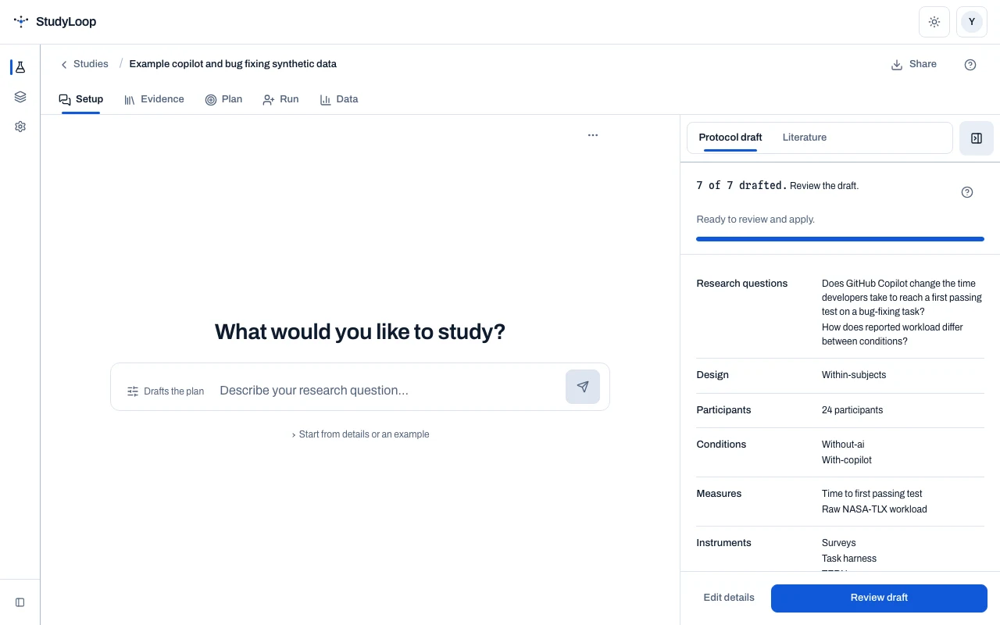
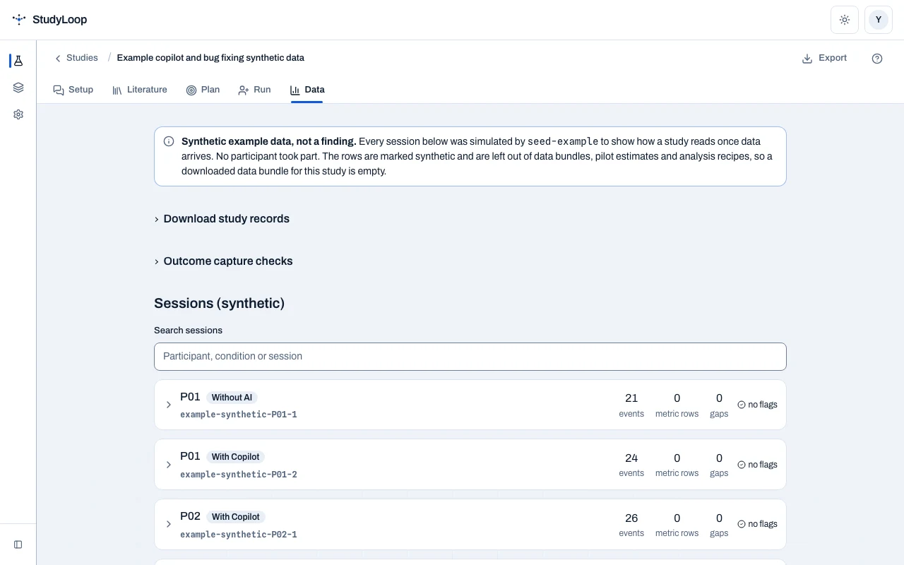

<p align="center">
  
</p>

<h1 align="center">StudyLoop</h1>

<p align="center">Design, run, and analyse studies of developers working with AI.</p>

<p align="center">
  <a href="#quickstart">Quickstart</a> ·
  <a href="#connect-a-model">Model setup</a> ·
  <a href="#run-a-study">Study workflow</a> ·
  <a href="CONTRIBUTING.md">Contributing</a> ·
  <a href="LICENSE">MIT license</a>
</p>

**PHOENIX** is the researcher's workspace for designing a study, planning
recruitment, and inspecting data. **TERN** is the VS Code extension
participants use. The protocol you approve connects the two. It records the
tasks, conditions, measures, consent, and capture settings for each study.

<picture>
  <source media="(prefers-color-scheme: dark)" srcset="documentation/docs/assets/screens/setup-dark.webp">
  
</picture>

## Quickstart

Install Git, [Node.js 22.13+ or a newer LTS release](https://nodejs.org/en/download),
and [uv](https://docs.astral.sh/uv/getting-started/installation/). StudyLoop uses
Python 3.12, which uv can install for you.

```sh
git clone https://github.com/idreesshaikh/human-ai-studies-framework.git
cd human-ai-studies-framework
uv sync --package middleware --no-dev --frozen
npm --prefix platform ci
npm --prefix platform run build
uv run --no-sync python scripts/run_demo.py
```

Open <http://127.0.0.1:8000> and select the study marked **synthetic data**.
Try **Plan** to inspect the recruitment assumptions, **Run** to see the
participant roster, or **Data** to explore session checks and exports.
The demo needs no account, API key, or VS Code extension. Ctrl+C stops the
server and removes its temporary data. [Example walkthrough](docs/demo-walkthrough.md)

### Keep your own studies

Stop the demo, copy the settings file once, then start the regular server.

```sh
cp .env.example .env.local
uv run --no-sync --env-file .env.local python -m middleware
```

In PowerShell, use `Copy-Item .env.example .env.local` for the first line.
The example settings listen on your own machine and save studies in
`.study-data/`. Templates, manual protocol entry, recruitment planning, and
exports work without a model. The bundled literature index fills in the
background on the first run. [Server configuration](middleware/README.md)

## Connect a model

Edit `.env.local`, then restart the server with the same `--env-file` command.
Keep credentials in that local file, which Git ignores.

### Mistral

In Mistral Studio, open **API Keys**, choose **New key**, and copy it into
`.env.local`. StudyLoop uses its default Mistral model unless you set
`LLM_MODEL` to another model available to your account.
[Mistral's API key guide](https://docs.mistral.ai/getting-started/quickstarts/studio/activate-and-generate-api-key)

```dotenv
LLM_API_KEY=your-mistral-key
```

### Ollama on your machine

Install and start the Ollama app, or run `ollama serve` in a separate terminal
if you installed only the CLI. Then pull a model.
[Install Ollama](https://ollama.com/download) · [Example model](https://ollama.com/library/qwen2.5:7b)

```sh
ollama pull qwen2.5:7b
```

```dotenv
LLM_BASE_URL=http://127.0.0.1:11434/v1
LLM_MODEL=qwen2.5:7b
LLM_API_KEY=
```

### Another OpenAI-compatible provider

Set `LLM_BASE_URL` to the provider's HTTPS API base, `LLM_API_KEY` to its API key,
and `LLM_MODEL` to the exact model ID. Choose a chat model that supports JSON
output through `response_format: json_object`. Use `LLM_DESIGN_MODEL` if you
want a separate model for design chat. [Model settings and troubleshooting](middleware/README.md#model-settings-and-troubleshooting)

Hosted providers receive the text of the design conversation and retrieved
literature. Keep participant details out of design prompts and review your
provider's data terms before use. [Security and participant data](SECURITY.md)

## Run a study

| Step | What you do |
| --- | --- |
| **Setup** | Start from a template, write the protocol yourself, or review model-proposed decisions. Apply the compiled protocol when it matches your study. |
| **Literature** | Collect the papers behind your design and link them to protocol decisions. |
| **Plan** | State your assumptions and save a recruitment estimate against the protocol version. |
| **Run** | Create participant links and give participants the TERN extension. Capture starts after consent. |
| **Data** | Inspect capture coverage, record pilot and inclusion decisions, and export data, a notebook, or a replication kit. |

Participants on other machines need a reachable HTTPS server and a TERN build
that matches your study. [Participant setup](documentation/docs/extension/install.md) ·
[Access and capture](SECURITY.md#access-and-capture)

<picture>
  <source media="(prefers-color-scheme: dark)" srcset="documentation/docs/assets/screens/data-dark.webp">
  
</picture>

Sample-size estimates depend on your assumptions. Editor and tool events are
observations that need independent validation before you draw conclusions about
AI use. Synthetic sessions are excluded from default research exports and
estimates. [Scope and study limits](docs/scope.md)

## Documentation and contributing

- [Researcher guide](documentation/docs/platform/index.md) and
  [participant setup](documentation/docs/extension/install.md)
- [Architecture](docs/architecture.md), [planning methods](docs/planner.md), and
  [measurement and privacy details](documentation/docs/extension/captured-data.md)
- [Contributing guide](CONTRIBUTING.md) and
  [security reporting](SECURITY.md)

If a setup step fails, include your OS, Python and Node versions, and the
command and error in a public issue. Use synthetic data in reproductions.
[Report an issue](https://github.com/idreesshaikh/human-ai-studies-framework/issues/new/choose)

StudyLoop is available under the [MIT License](LICENSE). If you use it in
research, cite the software and record the revision you ran. [Citation metadata](CITATION.cff)
