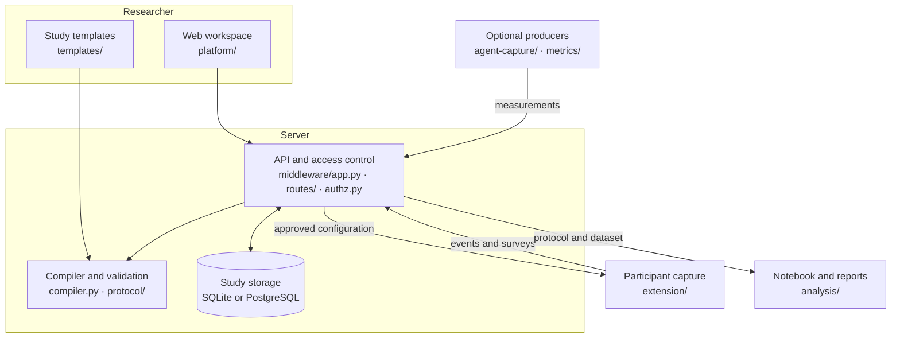
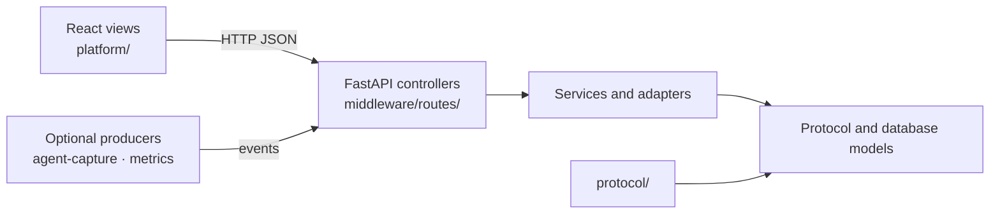
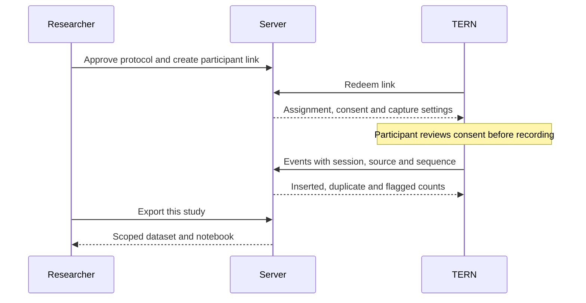

# Architecture

The protocol connects the researcher's intended study to capture and analysis.
The web app helps build it; the remaining tools consume it.

The supported product is a live, protocol-driven study. Optional producers
send measurements to the same ingest contract.

Python packages use a `src/` layout. For example, `middleware/app.py` below
means [middleware/src/middleware/app.py](../middleware/src/middleware/app.py).

## Design

### Boundaries

The code follows a small MVC-style split rather than a framework-specific
layering rule:

- **Models** are the protocol objects in `protocol/`, SQLAlchemy persistence
  models in `middleware/src/middleware/db.py`, and HTTP wire models in
  `middleware/src/middleware/schemas.py`.
- **Controllers** are the FastAPI endpoints in `middleware/src/middleware/routes/`.
  They authenticate requests, validate input, orchestrate a transaction, and
  shape the response. `app.py` composes their shared dependencies. Reusable
  domain rules belong in service modules.
- **Views** are the React components in `platform/src/`; they consume API
  responses and do not own study or database rules.
- **Services and adapters** are the focused modules beside the controller:
  `compiler`, `enrollment`, `matching`, `template_registry`, `corpus_refresh`,
  `corpus_screen`, `corpus_live`, `analysis`, `agent-capture`, and `metrics`.
  They can be tested without a browser.

`app.py` is the composition root: it builds the shared dependencies and registers
each route group from `routes/`. Give a new feature its own route module only when
the group has a clear service boundary; splitting a function merely to reduce a
line count would hide, rather than remove, coupling.

`platform/src/components/conversation/` renders turns, proposals, and the draft.
`middleware/design_assistant.py` frames each turn: the supported-scope check,
literature retrieval and citation grounding. `study_plan.py` holds the study plan
that the chat and the details form share, calls the model and validates its
proposals field by field into plan cards. `assistant.py` supplies the configured
chat-provider transport. There is no separate knowledge-chat interface.
Conversation routes read the study and generate the reply before opening a
write transaction. They commit the researcher message, reply, and proposed
changes together. Capture and other study writes can proceed while the model
is answering.

After researcher review, `middleware/compiler.py` folds accepted changes into
YAML and validates it through `protocol/loader.py`. The browser compiler in
`platform/src/lib/compiler.ts` provides a preview. The server is authoritative;
check both implementations when changing a move shape. Nothing becomes a study's
protocol until the researcher applies the reviewed draft. A study started from a
template keeps the template as an unapplied starting draft.

Literature reaches the chat without a chat-model call. `matching.py` ranks the
local corpus, and when it answers weakly `corpus_live.py` asks Semantic Scholar
for relevant papers within a 2.5 s budget, sending a few keywords and storing what
it finds. `corpus_refresh.py` collects new candidates on a schedule, and
`corpus_screen.py` screens them with SPECTER2 vectors from Semantic Scholar and,
on Mistral's API, `mistral-embed`.

`template_registry.py` validates and instantiates designs from
`templates/registry/`. Candidates in `templates/drafts/` need human review.

## Capture and storage

`protocol/assignment.py` assigns task/condition blocks. `capture.py` and
`derive.py` produce the capture configuration and session manifest.
`middleware/enrollment.py` issues and redeems participant links. A link stores
the protocol it was issued under, and pairing and each session's capture settings
come from that copy, so a later change applies only to links issued after it.

`extension/src/core/` holds capture logic; `extension/src/vscode/` connects it
to the editor. Optional external tools consume the same session identity.
Each producer owns a sequence stream; `(sessionId, source, seq)` identifies
an event and makes replay idempotent.

`middleware/db.py` defines tables and schema upgrades. `ingest_core.py` inserts
events and metrics. `auth.py` resolves identity; `authz.py` checks membership.
`SessionOpen` and `SessionBlock` map sessions to studies. Per-study reads use
`_session_scope`; `_joined_rows` applies it before dataset, notebook, and
replication-kit export. Only a single-user boot-protocol study may adopt unmapped
legacy sessions.

TERN telemetry excludes source and clipboard text. External transcript policies
can allow content; workspace snapshots store source locally. The chat model
receives the design conversation and literature, not participant event rows.
Semantic Scholar receives search keywords and `mistral-embed` receives candidate
paper text; neither receives study data.

## Planning and analysis

`analysis/planner.py` provides pure analytic and seeded simulation power calculations. `POST /studies/{id}/plan` checks them against the recorded protocol and stores an immutable protocol snapshot/hash. The compatibility `/power` route uses the same engine. Protocol v6 declares typed event-linked measures and survey wording/scales; the extension captures instrument version/hash, pre-task covariates and session tool provenance. Real pilot tags and audit decisions are recorded with identity/date, and the pilot update returns before/after recruitment and variance intervals. See [planner methods and limits](planner.md).

`analysis/dataset.py` prepares the joined dataset. Recipes register required
events and metrics in `analysis/core.py`. `runner.py` checks the plan and writes
tables, figures, and reports. `notebook.py` supplies a notebook and dictionary;
`protocol/export.py` packages a reproducible replication kit.

`GET /studies/{id}/data-bundle` (`middleware/export_bundle.py`) exports collected
data as a deterministic zip: one UTF-8 CSV per event type, the joined timeline
(`events/all.json`), `protocol.yaml`, a data dictionary, uploaded files, and
`manifest.json`. The manifest records the format version, protocol id, version
and sha256, event schema versions, each participant's condition, whether dry-run
rows are included (they are not by default), and a sha256 per member. The bundle's own
`README.md` documents the layout. The platform offers it in the Data tab and the
study header's Export menu.

Confirmatory dataset views omit whole pilot, synthetic and researcher-excluded sessions. Raw exports preserve real pilot rows, decisions, and instrument/session provenance. Data bundles and replication kits include a JSON/Markdown design card, which reports recorded assumptions and audit signals without rating validity. Re-run lineage comparisons authorize both studies and never pool data automatically.

## Where maintenance is needed

Keep route handlers thin and access-control tests at their feature boundary.
Keep optional producers out of the server's hard dependencies. Protocol `phases` remains for schema
compatibility; there is no phase-transition service.

The model and paper services are tested with fixtures. Tests do not establish
live-provider availability or methodological validity. See
[contributing](../CONTRIBUTING.md) for reproducible checks.
