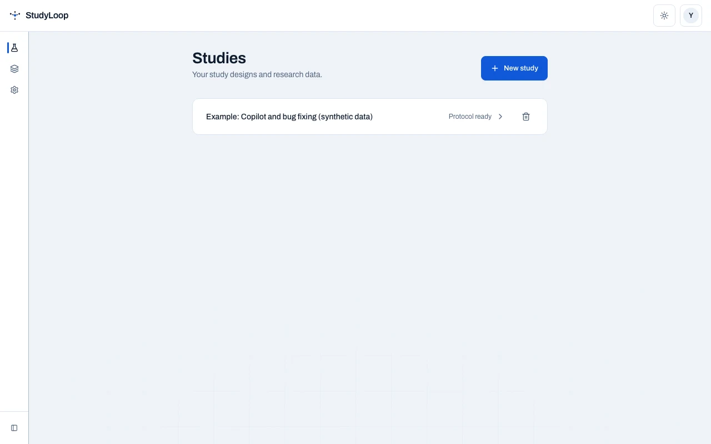

# Your first study

This page takes a new study from an empty list to its first participant link,
and shows where each step is explained in full. It assumes PHOENIX is running;
see [Install and run](index.md).

## 1. Create the study

On **Studies**, choose **New study**, enter a **Study name** and choose
**Create study**. With no studies yet, the page offers **New study** and
**Browse templates**. The study opens on its **Setup** tab. On the Studies page
each study shows **Setup in progress** or **Protocol ready**. The name you type is
remembered in this browser; elsewhere PHOENIX shows the study's ID as words.



## 2. Put the design in the protocol draft

On **Setup**, choose one of three routes. You can mix them: each one adds to the
same protocol draft beside the chat.

- **Describe the study** to the assistant, which needs a connected model.
  [Design conversation](../platform/design-conversation.md)
- **Start from a template**, a standard design with its analysis plan. Choose
  **Templates** in the sidebar, then **Use this template**: it creates the study
  with the template's design as its draft and opens it on **Setup**, ready to
  review and apply. [Templates](../platform/templates.md)
- **Enter protocol manually** if you already know the design.
  [Enter the protocol details directly](../platform/manual-entry.md)

## 3. Review and apply the protocol

Choose **Review draft**, check the compiled protocol and choose
**Apply protocol**. Nothing from the chat, a template or the details form reaches
a participant before this step, and **Plan**, **Run** and **Data** ask you to
apply the protocol first.
[Review and apply the protocol](../platform/protocol-draft.md)

## 4. Collect the literature

On **Literature**, add the papers behind your design and link each one to the
protocol decisions it supports. [Literature](../platform/library.md)

## 5. Plan recruitment

On **Plan**, enter your assumptions and save a recruitment estimate against the
protocol. [Plan recruitment](../platform/planning.md)

## 6. Run the study

On **Run**, create participant links and give participants TERN. Pilot first with
a few real participants. [Participant links](../platform/participants.md) and
[Give participants TERN](../platform/give-participants-tern.md)

## 7. Read the data

On **Data**, check each session as it arrives, tag pilots, record inclusion
decisions and download the records. [Review sessions and export](../platform/data.md)

## Around the workspace

- The sidebar has **Studies**, **Templates** and **Account settings**, where you
  can choose a light or dark theme.
- The study header has **Export**, which offers **Data (.zip)**, **Design card
  (.md)**, **Replication kit**, **Elicitation record** and **Starter notebook**,
  and a **?** button that opens a short tour of the tabs.
- The trash icon on a study in the Studies list deletes the study and its
  collected data after you confirm. This cannot be undone.

## How PHOENIX and TERN connect

```text
Protocol in PHOENIX
   │  consent statement, capture settings, assigned condition
   ▼
TERN in VS Code ── writes a local file first ──► study server ──► Data tab
```

The protocol is the only thing that configures a participant's session. TERN
shows its consent statement, applies its capture settings and receives the
condition the server assigns, which it never shows to the participant.

## Next steps

- [Design a study](../platform/index.md)
- [Explore the example study](example-study.md) if you have not yet
