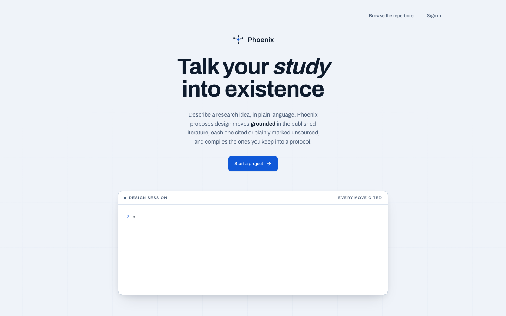

# StudyLoop · Human–AI Study Framework

*This is the user guide, built with MkDocs from `documentation/`. Developer and architecture documentation lives in the repository's `docs/` folder.*

**StudyLoop** is the project and framework. Its two components keep their names:
**PHOENIX**, the researcher platform, and **TERN**, the participant extension
for VS Code. They share an approved study protocol and analysis handoff.

## From a research question to a recorded protocol

PHOENIX is the researcher-facing half of the framework: a grounded design
conversation, a deterministic protocol compiler, a participant hand-off, and a
reproducible analysis path in one place. **TERN** is the participant-facing half: a
small VS Code extension that runs the approved study and records only the
signals the protocol permits.

<figure markdown="span">
  { width="900" }
  <figcaption>Start with the question, not a blank form. PHOENIX turns plain language into explicit, reviewable study decisions.</figcaption>
</figure>

## The whole project, in one spine

| Researcher action | PHOENIX provides | TERN provides |
| --- | --- | --- |
| Frame the question | Literature-grounded design moves with citations or an explicit unsourced label | — |
| Freeze the method | A versioned protocol, validation, consent statement, and capture configuration | Reads only the approved configuration |
| Rehearse the study | Labelled synthetic examples through real ingest; research exports exclude simulated rows | — |
| Invite a participant | A pairing link and protocol-derived task assignment | Reads the study configuration in VS Code after consent |
| Run the session | Live session and integrity visibility | Timer, probes, behaviour signals, local JSONL, optional HTTP mirror |
| Make the result portable | Dataset, dictionary, analysis recipes, notebook, and replication kit | — |

That separation is the thesis in product form: the platform makes the method
explicit and reproducible; the extension makes the participant experience
lightweight and privacy-preserving; the middleware makes the boundary between
them observable.

## What PHOENIX protects

- **Methodological coherence.** Accepted design moves compile into the protocol
  that configures the session. The chat cannot silently outrank the draft.
- **Evidence traceability.** Each grounded move carries its paper and confidence;
  a missing source is shown as missing rather than dressed up as certainty.
- **Participant dignity.** TERN records sizes, shapes, and timings—not raw code,
  keystrokes, clipboard text, or off-workspace paths. The consent statement and
  preflight summary are generated from the same approved capture config.
- **Analysis readiness.** Pilot sessions are tagged and kept out of confirmatory
  analysis, while sequence gaps and incomplete sessions remain visible instead
  of being quietly smoothed away.

## Two components, one workflow

- **[Platform](platform/index.md)** — design, compile, rehearse, recruit, curate.
- **[TERN Extension](extension/index.md)** — pair, consent, work, probe, debrief.

The [platform quick start](platform/quickstart.md) is the fastest route through
the complete loop. If you are a participant, start with [Installing TERN](extension/install.md).

## Try the release locally

Prerequisites: [uv](https://docs.astral.sh/uv/) and Node 22. The optional design
conversation uses the model configured in `.env`: `LLM_API_KEY`, `LLM_BASE_URL`
and `LLM_MODEL`. The default is `ministral-14b-latest` on Mistral's API.
`LLM_DESIGN_MODEL` overrides design alone; legacy `MISTRAL_*` names still work.
A local chat-completions server needs only `LLM_BASE_URL`. Manual authoring,
templates, capture and exports work without a model.

```bash
git clone https://github.com/idreesshaikh/human-ai-studies-framework.git
cd human-ai-studies-framework
uv sync --all-packages
(cd platform && npm ci && npm run build)
uv run --no-sync python scripts/run_demo.py
```

Open <http://127.0.0.1:8000> for a fresh disposable showcase with no provider
calls. Stop it with Ctrl+C; rehearsal changes are removed. For persistent work,
use the normal server with explicit storage configuration as described in the
[repository README](https://github.com/idreesshaikh/human-ai-studies-framework#readme).
Optional provider-backed sessions need exported settings or an explicit
`uv run --env-file .env` invocation. You can also run the
[TERN lab on GitHub](https://github.com/idreesshaikh/human-ai-studies-framework/tree/main/extension/examples/tern-lab)
in VS Code to see the participant side without pairing a real study.

!!! warning "Demo data is not a finding"
    The checked-in demo study and screenshots are synthetic fixtures. They exist
    to make the workflow tangible and to exercise integrity states; they must
    never be reported as empirical results.
