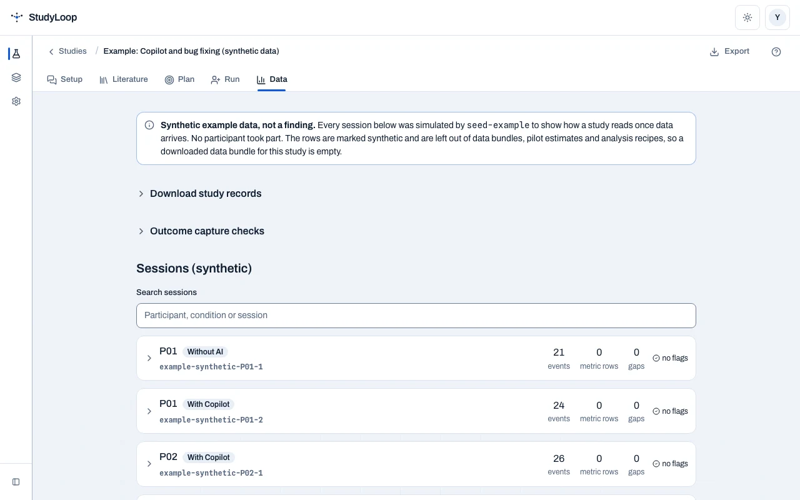

# Review sessions and export

The **Data** tab shows the sessions captured for the study, checks them for gaps,
records your decision on whether each one counts, and downloads the records. It
needs a protocol: until the study has one, the tab says **No data yet** and offers
**Open Setup**.

The tab runs from the top: **Download study records**, **Outcome capture checks**,
**Sessions**, **Session review**, **Measurements by condition** and **Recorded
analysis plan**. The example study's sessions are synthetic. They sit under a
notice that says so and are left out of exports.

## Review sessions

**Search sessions** filters by participant, condition or session ID. Each row shows
the participant, condition and session ID, the number of events, metric rows and
gaps in the event sequence, and a status: **no flags**, **Review capture** with a
count of flagged events, a count of missing events, or **in progress**.

Select a row to see its task, the flags it carries, how many events each source
sent, any required source that sent none, and a timeline with one lane per source.
Switch the timeline to a table with **Table**.

## Tag pilots and record decisions

Open **Session review** and select a session. **Show sessions** starts at **Needs
review**, the control sessions that need attention; choose **All sessions** to
decide on any session. For each one you can:

- tick **Pilot session**. Pilots stay in exports, marked, and are left out of
  confirmatory analysis and of **Measurements by condition**;
- set **Include in analysis** to **Include**, **Exclude** or **Undecided**.

Both need a **Reason for the decision or pilot tag**. Choose **Save decision**. Each
decision keeps its date and history, and with sign-in off the recorded identity is
`local`. Pilot sessions also feed [Update from tagged pilot
sessions](planning.md#update-from-pilot-sessions) on Plan.

## Download the records

**Download study records** has three buttons. The study header's **Export** menu
has those and two more.

| Download | What you get |
| --- | --- |
| **Data (.zip)** | One CSV per event type, the joined timeline, the protocol, a data dictionary and a manifest with checksums. Synthetic rows are left out; pilot tags and inclusion decisions are kept |
| **Design card (.md)** | The recorded design: planned power and assumptions, the analysis fixed in advance, measures and instrument wording, the tool and model versions each session recorded, audit results and inclusion decisions. It reports what was recorded and does not rate validity |
| **Replication kit** | The design card plus the frozen protocol, data and report, with pinned versions |
| **Elicitation record** | The conversation, decisions, sources, compilations and approvals behind the protocol (Export menu) |
| **Starter notebook** | The dataset and planned recipes, ready for your analysis, with nothing run (Export menu) |

Nothing in these files rates the study's validity, and repeated runs are never
pooled automatically.

## Read the results

Once real sessions arrive, **Measurements by condition** draws every observation
for the **Metric** you choose, by condition, as a **Chart** or a **Table**.
**Recorded analysis plan** lists the tests, effect sizes and corrections the
protocol fixed in advance. Read its assumptions before you interpret results. For
pilot updates, numerical limits and the audit, see the
[planner guide](https://github.com/idreesshaikh/human-ai-studies-framework/blob/main/docs/planner.md).

## Next steps

- [Check outcome capture](outcome-checks.md) after a rehearsal
- [Control-arm session review](control-arm-review.md)
