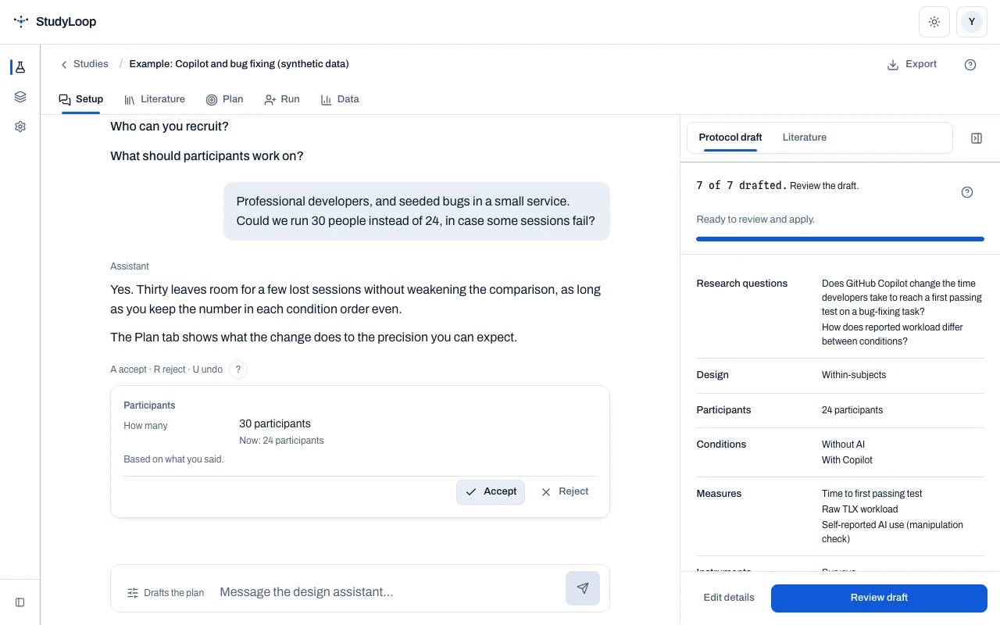

# The Setup tab

The **Setup** tab is where you design a study and where it becomes a protocol.
You describe the study, pick a template or enter the details, and PHOENIX fills in
the protocol draft beside the chat. Nothing reaches a participant until you review
the compiled draft and apply it.

## Three ways to fill the draft

You can use them in any order, and each one adds to the same draft.

| Route | Use it when | Needs a model |
| --- | --- | --- |
| [Design conversation](design-conversation.md) | You want to talk through options and trade-offs before deciding | Yes |
| [Templates](templates.md) | A standard design fits and you want its analysis plan | No |
| [Enter the protocol details directly](manual-entry.md) | You already know the design | No |

StudyLoop supports studies of coding tasks. It is not for exams, classrooms or
surveys.

## The protocol draft

The panel beside the chat, labelled **Protocol draft**, is the study's working
memory. It lists the sections of a protocol and what each one holds so far:

- research questions, design, participants, conditions, measures, instruments and
  statistical plan, which together make up the count of drafted sections
  ("3 of 7 drafted");
- **Ethics posture**, which is optional and records your safeguards. PHOENIX does
  not approve ethics.

The panel names the next undrafted section, and choosing it puts a prompt in the
chat box for you to edit and send. The **?** button, **What are these sections?**,
explains each section. The panel's second view, **Literature**, shows the papers
matched to the conversation. **Hide protocol draft** folds the panel into a strip.

**Edit details** opens the [details form](manual-entry.md) on top of the current
draft, and **Review draft** opens the compiled protocol for
[review and apply](protocol-draft.md).

## Then

1. Collect the papers behind the design on the [Literature](library.md) tab.
2. [Review and apply the protocol](protocol-draft.md).
3. Move on to [Plan](planning.md).

## Next steps

- [Design conversation](design-conversation.md) if a model is connected
- [Templates](templates.md) or [Enter the protocol details directly](manual-entry.md) if not
