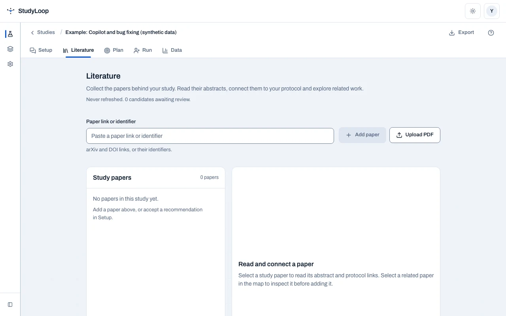

# Literature

The **Literature** tab holds the papers behind a study, the protocol decisions each
one supports, and a map of related work. Paper counts and citations describe the
collection. They do not establish the quality or validity of a study.

## Add papers

- Paste an arXiv or DOI link, or its identifier, into **Paper link or identifier**
  and choose **Add paper**. Looking a paper up makes a request to Semantic
  Scholar. A failed lookup keeps what you typed and says how to try again.
- Choose **Upload PDF** to add a file you supply. Uploaded files stay your
  responsibility.
- From the [design conversation](design-conversation.md), choose **Add to study**
  on a paper in the **Literature** view beside the chat.

From six papers on, **Filter papers** searches by title, author, year, venue or
identifier, and **Sort papers** orders by **Recently added**, **Title** or
**Newest publication**.

## Read a paper and link it to the protocol

1. Select a paper under **Study papers** to read its details and abstract.
   **Open source** opens its public page.
2. Enter the protocol identifiers it supports in **Protocol links**, separated by
   commas, such as `RQ-1, RQ-2`. Choose **Save links**. Unsaved links stay in the
   field while you look at other papers.
3. **Remove paper** asks for confirmation, then removes the paper and its links
   from the study.

If you have read-only access you can read the papers and links but not change
them.

## Explore related work

The **Literature map** shows what your papers cite, what cites them and similar
work. Choose **All**, **Earlier work**, **Later work** or **Similar work** to
filter by relation. Select a related paper to read it, and choose **Add to study** if it
belongs in the collection.

Zoom with the **+** and **-** buttons, drag the background to pan, or choose
**Fit**. With the map focused, the arrow keys move between papers and ++enter++ or
++space++ opens one.

## Where papers come from

The tab says when the bundled paper library was last refreshed and how many
candidates await review. The library itself is maintained by whoever runs the
server; see [Keep the literature library current](../reference/literature-library.md).
Paper metadata comes from Semantic Scholar and arXiv. Abstracts of recommended
papers are left out of conversation exports and replication kits, so that
Semantic Scholar abstracts stay out of them.

## Next steps

- [Review and apply the protocol](protocol-draft.md)
- [Plan recruitment](planning.md)
