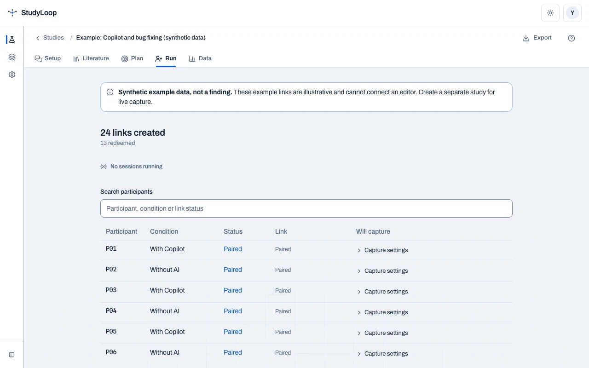

# Participant links

The **Run** tab connects people to the study. You create a link for each
participant, they open it in VS Code with [TERN](../extension/index.md), and their
sessions appear here while they run.

Run needs a protocol. Until the study has one, the tab says so and offers
**Open Setup**. The example study's links are illustrative and cannot connect an
editor, so **Create participant links** is off for it.

## Create links

Choose **Create participant links**:

| Field | What to choose |
| --- | --- |
| **How many** | A whole number from 1 to 100. Participant IDs continue in order: P01, P02, and so on |
| **Link type** | **Per participant**: reusable across a participant's sessions. **Per session**: single use, so create a new link for each session |
| **Study folder** | The task folder TERN opens after consent. See [Give participants TERN](give-participants-tern.md#the-study-folder) |
| **Capture settings** | Protocol defaults apply. Open the section to switch settings for every link in this batch, grouped as **Static metrics**, **Behavioral**, **Cognitive** and **Agent interaction** |

Choose **Create N links**. The dialog then lists each connection link with
**Open in VS Code** and **Copy**. Links expire after 30 days.

## Who gets which condition

The protocol assigns conditions; participants never choose, and TERN never shows
them theirs.

- **Within subjects, counterbalanced:** each participant meets every condition,
  and the order rotates across participants.
- **Within subjects, not counterbalanced:** every participant meets the
  conditions in the same order.
- **Between subjects:** each participant gets one condition, assigned in turn.

## The roster

Every link is a row. **Search participants** filters by participant, condition or
status.

| Column | What it shows |
| --- | --- |
| **Participant** and **Condition** | The ID and the condition the protocol assigned |
| **Status** | **Not used yet**, **Paired**, **Sending data** or **Revoked** |
| **Link** | **Copy link** and an **Open in VS Code** button while the link is unused |
| **Will capture** | **Capture settings**, which lists the instruments the link records and whether each is on |

Selecting an instrument in **Will capture**, where you have permission, opens a
switch for that setting. It edits the study's protocol and is recorded in the
study's decision history. The change applies to links you create afterwards.
Each link keeps the protocol it was issued under, so a participant's sessions
capture what they consented to; to change an issued link's capture, revoke it
and give the participant a new link.

**Revoke** stops a link from working. Choose **Revoke** again at **Revoke
permanently?** to confirm. This cannot be undone.

## Watch sessions

Above the roster, **N sessions running** lists each live session with its task,
condition, a small event-rate chart and its recent event count. A session with no events
for 30 seconds reads **quiet**, and a gap in the event sequence reads **N
missing**. This is the way to check that TERN's events are arriving. Run a small
pilot with a few real participants first and tag those sessions as pilots on
[Data](data.md). Pilot sessions stay in exports but are left out of confirmatory
analysis.

## Next steps

- [Give participants TERN](give-participants-tern.md)
- [Review sessions and export](data.md)
