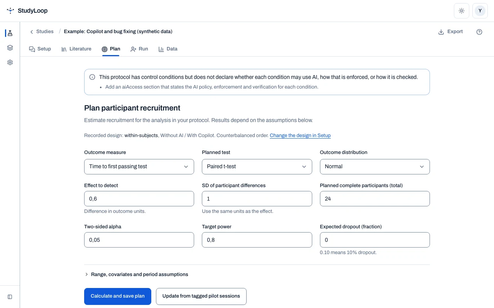

# Plan recruitment

The **Plan** tab estimates how many participants the analysis in your protocol
needs. Every number follows from assumptions you enter, and the tab shows them
next to the result. It never invents a sample size: when it cannot support a
combination, it says why.

Plan needs an applied protocol. Until the study has one, the tab says **Plan once
you have a protocol** and offers **Open Setup**. Once it has one, the tab shows the
recorded design, for example within-subjects with counterbalanced order, with a
link to change it in Setup.

## Estimate recruitment

1. Choose the **Outcome measure** and the **Planned test**. The tests offered are
   the ones your protocol's design and analysis plan support: **Mann–Whitney U**,
   **Wilcoxon signed-rank**, **Independent t-test / ANCOVA** or **Paired t-test**.
2. Choose the **Outcome distribution**: **Normal**, **Log-normal (completion
   times)** or **Ordinal (Likert ratings)**.
3. Enter the **Effect to detect** and the **Outcome SD**, or the **SD of
   participant differences** for a paired design. The hint under each field gives
   its units: outcome units, the log scale, or latent standard-deviation units
   for ordinal outcomes.
4. Set **Planned complete participants (total)**, **Two-sided alpha**, **Target
   power** and **Expected dropout (fraction)**, where 0.10 means 10%.
5. Optionally open **Range, covariates and period assumptions** to set the
   largest sample to explore, a pre-task covariate correlation, period and order
   effects for paired designs, and the simulation repetitions and seed.
6. Choose **Calculate and save plan**.

The result leads with **Recruit N participants**, then shows the power at the
estimated sample, a power curve, and a table of the smallest effect each planned
sample size can detect. t-tests and ANCOVA are computed directly. Rank tests are
simulated with a fixed seed and shown with a 95% simulation interval. If the target
is not reached within the explored range, no sample size is reported.

A saved plan is pinned to the exact protocol it was made for. If the protocol
changes afterwards, the tab says so and asks you to recalculate.

## Update from pilot sessions

Tag real pilot sessions on [Data](data.md), then choose **Update from tagged pilot
sessions**. The tab re-estimates the spread from the pilot participants and shows
the recruitment estimate before and after. With fewer than 8 pilot participants it
warns that the estimate is too wide to act on. Synthetic sessions are never used.

## AI access in control conditions

A warning appears at the top of the tab when the protocol has control conditions
but does not say whether each may use AI, how that is enforced and how it is
checked, or when a no-AI condition relies only on checks that cannot confirm
non-use. StudyLoop cannot verify that a control condition stayed free of AI. To see
what contamination does to your analysis, use
[Non-compliance sensitivity](non-compliance.md).

For effect units, covariate and period limits and the numerical checks behind the
planner, see the
[planner guide](https://github.com/idreesshaikh/human-ai-studies-framework/blob/main/docs/planner.md).

## Next steps

- [Non-compliance sensitivity](non-compliance.md)
- [Create participant links](participants.md)
