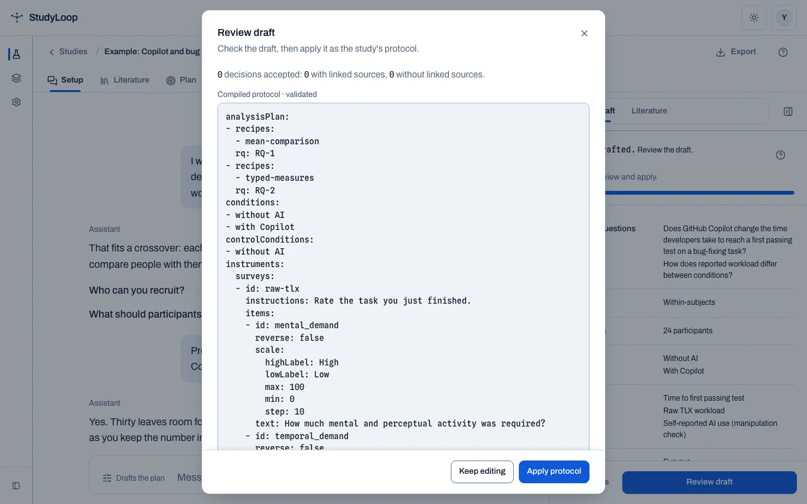

# Review and apply the protocol

Whatever route you used to fill the protocol draft, it becomes the study's
protocol only when you review the compiled version and apply it. This page covers
that review, what applying changes, and what to do when the protocol changes
later.

## Review the draft

Choose **Review draft**. It is at the foot of the **Protocol draft** panel, and in
the Setup header when the panel is hidden or the window is narrow. The dialog
shows:

- how many decisions you accepted, and which ones have a linked source (marked
  **cited**) and which do not (**no linked source**). Only sources linked to a
  decision are counted; papers on the Literature tab are listed separately;
- the **Compiled protocol** as YAML, marked **validated** or **not yet valid**;
- what changed since the version you last applied, when there is an earlier
  version;
- the compiler's notes on anything it added or changed in your draft;
- the errors and the sections that are **Still unresolved**, if any.

## Apply it

Choose **Keep editing** to go back, or **Apply protocol** to make this version the
study's protocol. PHOENIX records who applied it, and the dialog then offers
**Applied. Plan recruitment**. **Apply protocol** stays off while the protocol is
invalid or a core section is still empty.

Until you apply one, **Plan**, **Run** and **Data** ask you to apply the protocol
first. That includes a study that started from a [template](templates.md): the
template is only its starting draft, so review it here before you plan or recruit.

The applied protocol sets:

- the conditions and the order each participant meets them in;
- the measures and the instruments that capture them;
- the consent statement TERN shows when a participant connects;
- TERN's capture settings;
- the analysis plan and the checks it must pass.

## How compiling works

- **No model is involved.** The compiler turns your accepted decisions into a
  versioned YAML protocol the same way every time.
- **It is checked.** Missing conditions, measures or participant counts are named
  as errors and never filled in with defaults.
- **The server decides.** Your browser previews each decision at once, then the
  server compiles again. If the server finds an error, **Apply protocol** stays
  blocked.

## Changing the protocol later

You can reopen **Setup** at any time, change the draft and apply it again. A new
version governs the participant links you create afterwards. Each link keeps the
protocol it was issued under, so a participant's sessions record what they
consented to, and TERN does not ask for consent again. To change what an issued
link captures, revoke it and give the participant a new link. Links created before
StudyLoop stored this have no saved protocol and follow the current one.

## Consent and responsibility

PHOENIX does not grant ethics approval. It makes the capture decision explicit:
the participant sees a consent statement written from the protocol, and TERN
applies the protocol's capture settings. You remain responsible for review by
your institution and for deciding when a change needs a new review.

## Next steps

- [Collect the literature](library.md) behind your decisions
- [Plan recruitment](planning.md)
