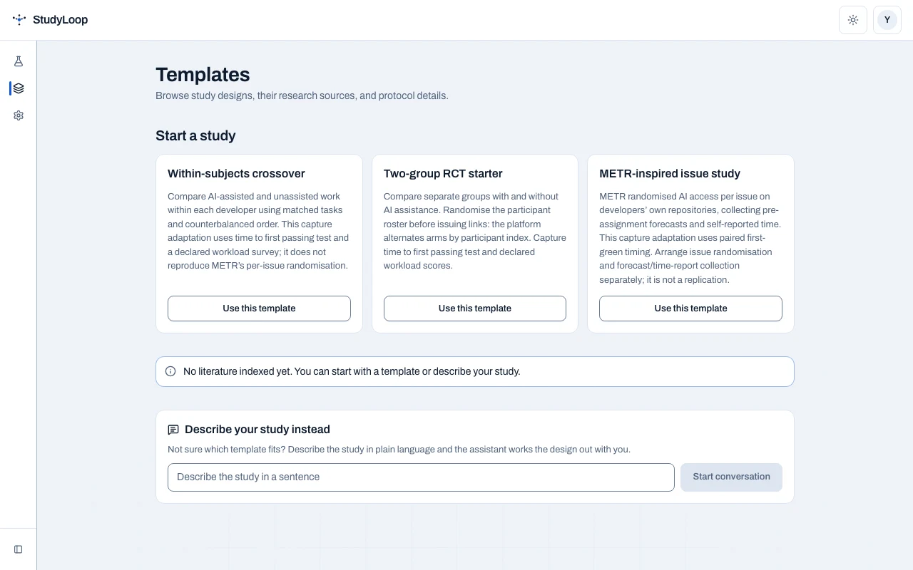

# Templates

A template is a standard study design with its analysis plan, backed by the
papers that use it. **Templates**, in the sidebar, ranks the designs by how many
papers in StudyLoop's literature corpus use each one. **Use this template**
creates a study with that design as its draft, so you do not need a model.

## Start from a template

1. Choose **Templates** in the sidebar.
2. Pick a design. **Start a study** at the top shows the featured ones, and
   **Study templates** below lists every design in the registry. Open a card to
   read its description, its design type and its **References**, each with the
   reason it matched.
3. Choose **Use this template**. StudyLoop creates a study named after the
   template, with the template as its protocol draft, and opens it on **Setup**.
4. Change whatever does not fit your study, in the chat or with **Edit details**
   ([Enter the protocol details directly](manual-entry.md)), then choose
   **Review draft** and **Apply protocol**. Plan, Run and Data open once the
   protocol is applied, as for any other study.

A template is a design shape and not a replica of any paper: the references are
the evidence for the shape. The protocol it produces is yours to review.

## What the page tells you

- **Papers.** The number on each card is how many corpus papers match the design.
  It describes how common the design is, not how good it is.
- **Held back.** Designs too rare to propose without a strong source sit under
  **Held back**, with the reason. You can still use them.
- **Indexing.** The ranking needs the literature corpus. While it loads, the page
  shows how many papers are indexed so far, and the featured templates still work.
  See [Install and run](../get-started/index.md#run-your-own-server).

## Describe your study instead

If no template fits, type a sentence in **Describe your study instead** and
choose **Start conversation**. StudyLoop creates a study and opens the
[design conversation](design-conversation.md) with your sentence as the first
message. This needs a connected model.

## Next steps

- [Review and apply the protocol](protocol-draft.md)
- [Plan recruitment](planning.md)
